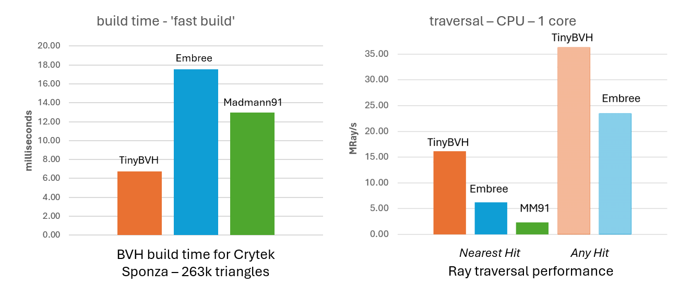
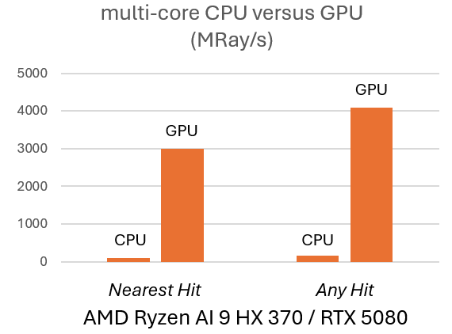
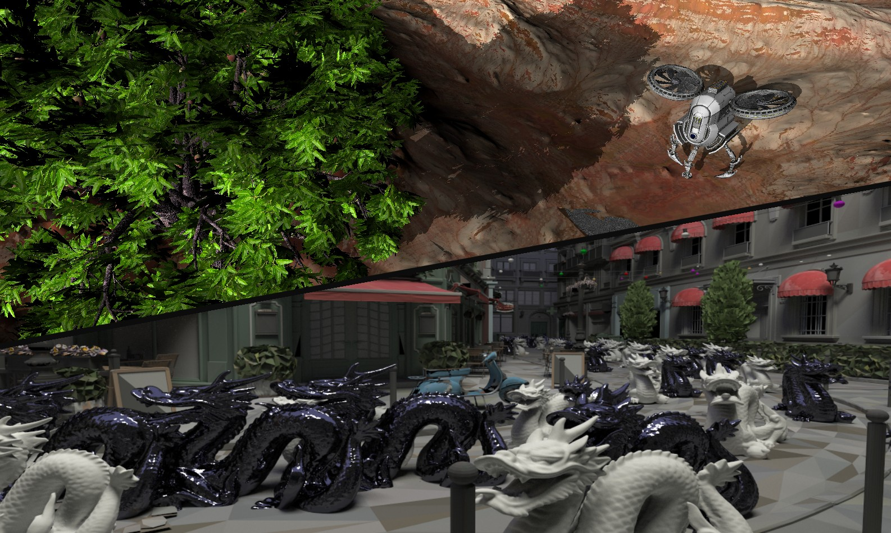
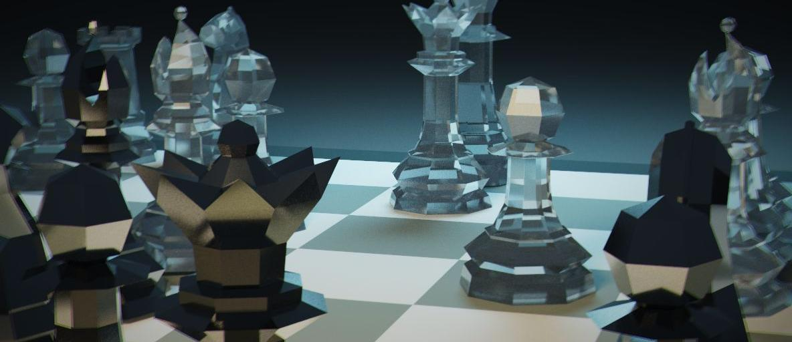
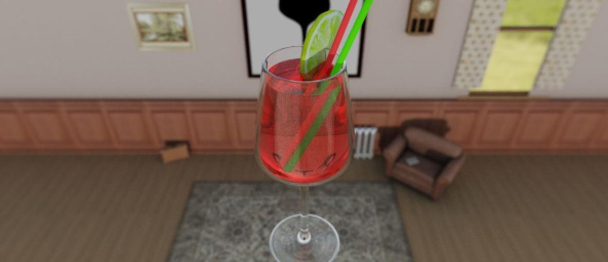

# TinyBVH

Header-only BVH construction and traversal library, written in C++14 / "Sane C++" (or "C with classes"). C++17 is used for threading. **This library has no dependencies.**

Current version: **1.9.1**.

TinyBVH is _fast_. Here is, in a nutshell, how it compares to [Intel's Embree](https://www.embree.org) and [Madmann91's BVH library](https://github.com/madmann91/bvh):



TinyBVH currently builds a SAH BVH faster than Embree and Madmann91. It also traces individual primary and 'any hit' rays faster than those libraries. Note: these results are based on the `tiny_bvh_benchmark.cpp` application and are cautiously presented as 'preliminary'. Single-ray traversal is only a small part of Embree. If you suspect an imperfection in the experiment setup, please [let me know](mailto:bikker.j@protonmail.com).



When tracing rays on the GPU, (multicore) CPU performance is dwarfed. On an RTX 5080 laptop GPU, TinyBVH traces up to _5 billion rays_ per second in Crytek's Sponza scene using the basic binary BVH format, regardless of graphics API and without using specialized ray tracing hardware. That is 5 rays per pixel at 4k@120Hz, enough for most purposes.

---

**Contents:** [Getting started](#getting-started) &middot; [BVH?](#bvh) &middot; [Builders](#builders) &middot; [Layouts](#layouts) &middot; [Geometry input](#geometry-input) &middot; [Traversal](#traversal) &middot; [TLAS, instancing and custom geometry](#tlas-instancing-and-custom-geometry) &middot; [Maintaining a BVH](#maintaining-a-bvh) &middot; [Offline optimization: bvhopt](#offline-optimization-bvhopt) &middot; [Memory and threading](#memory-and-threading) &middot; [Configuration](#configuration) &middot; [Examples](#examples) &middot; [GPU ray tracing and TinyOCL](#gpu-ray-tracing-and-tinyocl) &middot; [Platforms](#platforms) &middot; [Feature list](#feature-list) &middot; [TinyBVH in the wild](#tinybvh-in-the-wild)

---

# Getting started

The library consists of `tiny_bvh.h` and the `tiny_bvh_*.h` headers next to it:

| file | contents |
| --- | --- |
| `tiny_bvh.h` | configuration, platform detection; **the only header application code includes** |
| `tiny_bvh_base.h` | platform-neutral code: types, builders, traversal, TLAS, voxels |
| `tiny_bvh_x86_float.h` | SSE / AVX / AVX2 kernels for the single precision layouts |
| `tiny_bvh_x86_double.h` | x86 kernels for the double precision layouts |
| `tiny_bvh_arm_float.h` | NEON kernels for the single precision layouts |
| `tiny_bvh_arm_double.h` | ARM kernels for the double precision layouts |

Keep them together and include only `tiny_bvh.h`. Define `TINYBVH_IMPLEMENTATION` in exactly one translation unit:

```cpp
#define TINYBVH_IMPLEMENTATION
#include "tiny_bvh.h"
```

Build a BVH and trace a ray:

```cpp
tinybvh::BVH bvh;
bvh.Build( (tinybvh::bvhvec4*)myTriData, triangleCount );

tinybvh::Ray ray( tinybvh::bvhvec3( 0, 0, 0 ), tinybvh::bvhvec3( 0, 0, 1 ) );
bvh.Intersect( ray );
if (ray.hit.t < BVH_FAR)
{
    // ray.hit.prim, ray.hit.u, ray.hit.v
}
```

`myTriData` holds three vertices per triangle, each four floats: x, y, z and a dummy value that exists purely for a more efficient memory layout. Shadow rays use `bvh.IsOccluded( ray )`.

See [`tiny_bvh_minimal.cpp`](https://github.com/jbikker/tinybvh/blob/dev/examples/tiny_bvh_minimal.cpp) for a (really) small example. A more complete overview of TinyBVH functionality can be found in the [Basic Use Manual](https://jacco.ompf2.com/2025/01/24/tinybvh-manual-basic-use) and the [Advanced Topics Manual](https://jacco.ompf2.com/2025/01/25/tinybvh-manual-advanced).

**Note on ray direction:** since 1.9.x, `Ray` does not normalize the direction in its constructor. Call `ray.Normalize()` where you need a normalized direction, or `#define NORMALIZE_RAY_DIR` to restore the previous behaviour.

# BVH?

A Bounding Volume Hierarchy is a data structure used to quickly find intersections in a virtual scene; most commonly between a ray and a group of triangles. You can read more about this in a series of articles on the subject: https://jacco.ompf2.com/2022/04/13/how-to-build-a-bvh-part-1-basics .

# Builders

`Build` forwards to a specialized builder, selected via `BVHBase::settings`. There are fast builders, builders for 'high quality' BVHs, and experimental builders for research and development:

| setting | builder |
| --- | --- |
| _(default)_ | **Bonsai** ([Ganestam et al., 2015](https://www.highperformancegraphics.org/wp-content/uploads/2015/Papers-Session1/HPG2015_BonsaiGrowingTreelets.pdf)): grid cells become mini trees, built in parallel on top of the SIMD binned SAH code, then pruned and combined under a top tree. |
| `useSpatialSplits` | **Bonsai HQ** (Ganestam & Doggett, 2016): SAH-guided triangle splitting during Bonsai partitioning. |
| `binnedBVH` | **Binned SAH**, using the AVX (x86) or NEON (ARM) SIMD builder. |
| `binnedBVH` + `useSpatialSplits` | **SBVH** ([Stich et al., 2009](https://www.nvidia.in/docs/IO/77714/sbvh.pdf)), including "unsplitting". |
| `useSIMDifavailable = false` | Scalar reference binned SAH builder; SBVH if `useSpatialSplits` is set. |
| `useFullSweep` | Full-sweep SAH builder, for experiments (with support from [BoyBaykiller](https://github.com/BoyBaykiller)). |
| `useHPLOC` | H-PLOC; builds trees identical to the NexusBVH CUDA code, for comparisons. |
| _(method)_ | `BuildQuick`: single-function midpoint-split builder, for reference and debugging. |

Supporting options in `BVHBuildSettings`:

```cpp
struct BVHBuildSettings
{
    bool usePresplitting = false;   // pre-split triangles before building the BVH.
    bool useSpatialSplits = false;  // split triangles during construction: Bonsai HQ, or SBVH with binnedBVH.
    float minSpatialOverlap = 1e-3f;     // for SBVH: minimal overlap; if less, a spatial split is avoided.
    bool spatialSkipSmallestAxis = true; // for SBVH: skip smallest axis for spatial splits.
    bool presplitPostPass = true;   // attempt to un-split primitives in leaves after a presplit build.
    float presplitFactor = 0.3f;    // presplit budget relative to input data size.
    bool useFullSweep = false;      // for experiments only; full-sweep SAH builder.
    bool binnedBVH = false;         // use the binned SAH builders instead of Bonsai.
    uint32_t bonsaiGridPrims = 256; // Bonsai: grid resolution target, in primitives per grid cell.
    float bonsaiPruneFactor = 0.1f; // Bonsai: prune mini trees larger than this fraction of the average; 0 disables.
    bool useHPLOC = false;          // H-PLOC builder.
    bool postOptimize = false;      // optimize generated BVH using tree rotations.
    int optimizeIterations = 25;    // default optimization iterations.
    bool useSIMDifavailable = true; // set to false to use the scalar reference builder.
    bool enableThreading = true;    // default to threaded builds.
    bool discardIntermediates = false;   // do not keep original BVH after conversion.
    bool minimizeMemUse = true;     // size intermediate data exactly, at a small cost in build time.
};
```

Settings are per-BVH and are passed on to the layouts a BVH is built from, so a `BVH8_CPU` or `BVH8_CWBVH` picks up the same build configuration:

```cpp
tinybvh::BVH4_CPU bvh;
bvh.settings.useSpatialSplits = true;   // Bonsai HQ
bvh.Build( (tinybvh::bvhvec4*)myTriData, triangleCount );
```

`BuildHQ` is shorthand for `useSpatialSplits = true` followed by `Build`; `BuildSIMD` invokes the SIMD builder directly. Both remain available, but the settings struct is the preferred interface.

SAH construction is steered by `c_int` (primitive intersection cost) and `c_trav` (traversal step cost), which default to `C_INT` and `C_TRAV` and can be set per BVH. `hqbvhbins`, `hqbvhoddeven` and `hqLeafPrims` tune the high-quality builders.

# Layouts

Apart from the default layout (simply named `BVH`), several other layouts are available, each serving one or more specific purposes. Instantiate the class you need; it builds the intermediate representations it requires internally.

| layout | description |
| --- | --- |
| `BVH` | 32-byte nodes storing the node AABB, child pointer and leaf info in a cross-platform-friendly way; two nodes per cache line. Every other layout is produced from this one. |
| `BVH_Verbose` | 64-byte nodes with explicit child and parent indices. Exists primarily for tree surgery and the BVH optimizer. |
| `MBVH<M>` | Templated M-wide format: each node stores _M_ child pointers, reducing tree depth. Improves performance for divergent rays. Based on the [2008 paper](https://graphics.stanford.edu/~boulos/papers/multi_rt08.pdf) by Ingo Wald et al. |
| `BVH4_CPU` | AVX2 / NEON-optimized 4-wide traversal (["WiVe"](https://web.cs.ucdavis.edu/~hamann/FuetterlingLojewskiPfreundtHamannEbertHPG2017PaperFinal06222017.pdf)), with octant-specialized kernels and four triangles per leaf. **This is the fastest option on CPU.** |
| `BVH8_CPU` | AVX2-optimized 8-wide traversal (WiVe). `BVH4_CPU` is now faster; this format is left in for reference. |
| `BVH_GPU` | 64 bytes per node, storing the AABBs of both children: the format from the [2009 Aila & Laine paper](https://research.nvidia.com/sites/default/files/pubs/2009-08_Understanding-the-Efficiency/aila2009hpg_paper.pdf). Traversed with a simple GPU kernel. |
| `BVH4_GPU` | Compact quantized 4-wide format, which may be faster for GPU ray tracing. |
| `BVH8_CWBVH` | Advanced 80-byte 8-wide representation for state-of-the-art GPU rendering, based on the [2017 paper](https://research.nvidia.com/publication/2017-07_efficient-incoherent-ray-traversal-gpus-through-compressed-wide-bvhs) by Ylitie et al. and [code by AlanIWBFT](https://github.com/AlanIWBFT/CWBVH). |
| `BVH4_AMD_HW` | 4-wide nodes in the AMD hardware BVH format (BOX32 and triangle nodes), for traversal using AMD ray tracing hardware. By Alessandro Salo.|
| `VoxelSet` | A 256³ brick-based voxel object with DDA traversal, which can be attached as a BLAS in a TLAS. Disable with `NO_VOXEL_SUPPORT`. |
| `BVH_Double` | Double-precision version of `BVH`, with 64-bit indices. |
| `BVH4_Double` | Double-precision version of `BVH4_CPU`, with AVX2 and NEON traversal kernels. |

Under the hood every layout is a template instantiated on scalar and index type: `<float, uint32_t>` for the single precision aliases and `<double, uint64_t>` for the double precision ones. The wide CPU layouts have a portable scalar traversal path, so they work everywhere; AVX2 and NEON kernels replace it where available.

# Geometry input

Vertices are passed as `bvhvec4`, three per triangle. On top of that:

```cpp
bvh.Build( vertices, indices, triangleCount );          // indexed geometry
bvh.Build( bvhvec4slice( vertices, count, stride ) );   // custom vertex stride
bvh.BuildAABB( aabbs, primCount );                      // BVH over AABBs
```

A `bvhvec4slice` lets TinyBVH read vertices straight out of an interleaved vertex buffer. Indexed geometry can be disabled with `NO_INDEXED_GEOMETRY`.

Geometry is referenced, not copied — with one exception: `BVH::Save` embeds the triangle data by default, so a saved `.bvh` file is self-contained, and a BVH loaded from such a file owns the geometry it brought with it (`FreeGeometry` releases it).

# Traversal

```cpp
int32_t steps = bvh.Intersect( ray );     // closest hit; result in ray.hit
bool occluded = bvh.IsOccluded( ray );    // any hit, for shadow rays
bool hit = bvh.IntersectSphere( pos, r ); // sphere/BVH collision detection
```

* **Hit record.** `ray.hit` holds `t`, barycentrics `u` and `v`, and `prim`. The instance index lives in a separate field, or in the top bits of `prim` when `INST_IDX_BITS` is set below 32. Beyond that, `Intersection` carries a `void*` and 64 bytes of user payload, aliased as chars, floats, ints or doubles.
* **Ray masks.** Each ray carries a 16-bit `mask`; each `BLASInstance` carries one too. Instances are skipped when the masks do not overlap (similar to [OptiX](https://raytracing-docs.nvidia.com/optix7/guide/optix_guide.230712.A4.pdf), contributed by [Romain Augier](https://github.com/romainaugier)).
* **Bundles.** `BVH` and `BVH4_CPU` provide `IntersectBundle` and `IsOccludedBundle`, which trace `TINYBVH_BUNDLE_RAYS` rays at a time using the WiVeC scheme (AVX2).
* **Opacity micro maps.** `SetOpacityMicroMaps( mapData, N )` attaches an N×N opacity map per triangle, as proposed [by Gruen et al.](https://dl.acm.org/doi/10.1145/3406180) in 2020. The SIMD leaf tests apply it directly.
* **Triangle intersection.** Default is Möller & Trumbore ([1997](https://cadxfem.org/inf/Fast%20MinimumStorage%20RayTriangle%20Intersection.pdf)); Baldwin & Weber ([2016](https://jcgt.org/published/0005/03/03/paper.pdf)) is used for the precomputed leaf formats; `WATERTIGHT_TRITEST` switches to 'watertight' intersection based on the [2013 paper](https://jcgt.org/published/0002/01/05/paper.pdf) by Woop et al., at a small additional cost.

# TLAS, instancing and custom geometry

TinyBVH supports construction of a _Top-Level Acceleration Structure_: a BVH over _Bottom-Level Acceleration Structures_, where each BLAS is a BVH with a 4x4 transform. Different layouts can be combined under a single TLAS, and a BLAS can appear multiple times with different transforms:

```cpp
tinybvh::BVH blas;
blas.Build( (tinybvh::bvhvec4*)myTriData, triangleCount );

tinybvh::BLASInstance inst[2];
inst[0].blasIdx = 0;
inst[1].blasIdx = 0;
inst[1].transform = myMatrix;   // instance transform; inverted by the TLAS build

tinybvh::BVHBase* blasList[] = { &blas };
tinybvh::BVH tlas;
tlas.Build( inst, 2, blasList, 1 );
tlas.Intersect( ray );
```

Changing the transforms and rebuilding the (small) TLAS gives cheap _rigid animation_ as well as instancing.

Custom primitives are supported through callbacks: supply the AABBs via a function pointer and point `customIntersect` and `customIsOccluded` at your own intersection code. This works for double-precision BVHs as well, and lets you mix triangles, custom geometry and voxel objects in one scene. Disable with `NO_CUSTOM_GEOMETRY`.

# Maintaining a BVH

* **Rebuild.** Call `Build` again on the changed triangle data at any time.
* **Refit.** `Refit` updates node bounds for moved triangles. It is substantially faster than rebuilding and works well if the animation is subtle; it does not work if polygon counts change, nor for trees with spatial splits — `isRefittable()` tells you which.
* **Optimize.** `Optimize( iterations )` reduces SAH cost and improves ray tracing performance using insertion-based tree rotations ([Bittner et al., 2013](https://dspace.cvut.cz/bitstream/handle/10467/15603/2013-Fast-Insertion-Based-Optimization-of-Bounding-Volume-Hierarchies.pdf)). It can also run as a build post-pass via `settings.postOptimize`. For static scenes, the stand-alone [`bvhopt`](#offline-optimization-bvhopt) tool goes considerably further.
* **Tree surgery.** `Compact`, `MergeLeafs`, `SplitLeafs` and `CollectNodes` manipulate an existing tree.
* **Quality metrics.** `SAHCost` and `EPOCost`; the latter implements the "End-Point Overlap" metric from ["On Quality Metrics of Bounding Volume Hierarchies"](https://users.aalto.fi/~ailat1/publications/aila2013hpg_paper.pdf), Aila et al., 2013, weighted by `W_EPO`.
* **Serialization.** `::Save` and `::Load` for most layouts. Every layout additionally has a static `Load` factory that returns a finished object: a plain-BVH file is converted to the target layout, and only that layout's data is kept.

# Offline optimization: bvhopt

`BVH::Optimize` runs in-process and is bounded by build time. Where quality matters more than anything — static geometry, a tree you build once and ship — `bvhopt` takes a saved BVH and writes a better one. It includes TinyBVH but is otherwise stand-alone, and reaches the tree through the public API only: none of its machinery lives in the library headers.

```
bvhopt <file.bvh> [mesh.bin] [options]
```

A BVH saved by a current TinyBVH carries its own geometry and needs nothing else. For an older file, pass the mesh it was built from, or leave it to default to `<file>.bin`; the geometry is needed either way, since EPO is defined over the triangles. The result is written to `<file>_opt.bvh` and is self-contained in turn. (`mkbvh` is a twelve-line helper that builds a `.bvh` from a mesh, to give the tool something to chew on.)

The tree is first exploded to one reference per leaf. Each round then applies insertion-based reinsertion in extreme mode, treelet restructuring by exact dynamic programming, rebuilds of the worst subtrees, and reference unsplitting. A final pass solves leaf formation exactly for small subtrees and collapses the tree back. Near the root, treelet candidates can be scored by exact local EPO instead of SAH, and `-epogate` validates a round against whole-tree EPO.

Options: `-rounds -reinsert -treelet -sweeps -rebuild -nounsplit -noexplode -exact -leaf -epotop -epocand -epogate -seed -quiet`. The defaults are the configuration that measured best. Progress is reported per stage per round; note that mid-run SAH is measured on the exploded tree and therefore looks worse than the input until the final collapse.

On Crytek Sponza (262k triangles), starting from a spatial-split Bonsai tree, a two-round run reduces SAH by about 8% and EPO by about 7.5% in under half a minute. Every option path is verified ray-exact against the input tree.

# Memory and threading

Each layout owns its buffers, so the classes are move-only: move construction and move assignment transfer ownership, and `ReferenceFrom`, `ReleaseOwnership` and `DropReference` let you share buffers between objects explicitly when you need to.

Allocation goes through `BVHContext`, which also carries the build hooks:

```cpp
struct BVHContext
{
    void* (*malloc)(size_t size, void* userdata);
    void (*free)(void* ptr, void* userdata);
    void (*spawn)(void (*fn)(void*), const void* payload, uint32_t payloadSize, void* userdata);
    void (*barrier)(void* userdata);
    void (*parallel_for)(uint32_t n, void (*fn)(uint32_t, void*), void* payload, void* userdata);
    void* userdata;
};
```

By default the hooks point at a built-in process-wide `std::thread` pool, which is created on the first threaded build and released at exit (or explicitly, via `tinybvh_shutdown_builtin_pool`). Define `TINYBVH_NO_BUILTIN_POOL` to supply your own pool instead ('Bring Your Own Thread Pool', thanks [Wenzel Jakob](https://github.com/wjakob)), or `NO_THREADED_BUILDS` to drop threading altogether — TinyBVH then compiles as C++14.

`settings.enableThreading = false` keeps a build on the calling thread. This is what you want when the application builds many BLASes at once, one per application thread.

Fatal errors go through `tinybvh_fatal_error`, which never returns; install your own reporter with `tinybvh_set_fatal_error_handler`.

# Configuration

Define these before including `tiny_bvh.h`:

| define | effect |
| --- | --- |
| `TINYBVH_IMPLEMENTATION` | emit the implementation in this translation unit |
| `BVHBINS` | bins used in regular BVH construction (default 8) |
| `HQBVHBINS` | bins used in SBVH construction (default 8, at most `MAXHQBINS`) |
| `C_INT`, `C_TRAV` | default SAH cost of a primitive intersection / traversal step |
| `W_EPO` | weight of 'end point overlap' in the EPO calculation |
| `INST_IDX_BITS` | bits used for the instance index; 32 stores it in a separate field |
| `TINYBVH_STACK_SIZE` | stack size for CPU traversal (default 128) |
| `TINYBVH_BUNDLE_RAYS` | rays per `IntersectBundle` call; multiple of 8, max 256 |
| `WATERTIGHT_TRITEST` | watertight ray/triangle intersection |
| `NORMALIZE_RAY_DIR` | normalize ray direction in the `Ray` constructor |
| `TINYBVH_USE_CUSTOM_VECTOR_TYPES` | 'Bring Your Own Vector Types'; alias your own types into the `tinybvh` namespace |
| `TINYBVH_ALIGNED_ALLOC` / `TINYBVH_ALIGNED_FREE` | user-defined aligned allocation (define both) |
| `TINYBVH_NO_BUILTIN_POOL` | do not create the built-in thread pool |
| `TINYBVH_NO_SIMD` | disable the SIMD paths |
| `NO_DOUBLE_PRECISION_SUPPORT`, `NO_INDEXED_GEOMETRY`, `NO_CUSTOM_GEOMETRY`, `NO_THREADED_BUILDS`, `NO_VOXEL_SUPPORT` | compile out the corresponding feature |

Threaded builds are tuned with a set of `MT_*` defines (spawn depth, task thresholds, slice sizes); see the top of `tiny_bvh.h`.

# Examples

A Visual Studio 'solution' (.sln/.vcxproj) is included, as well as a CMake file. That being said: most examples consist of a single source file, which can be compiled with clang or g++, e.g.:

`g++ examples/tiny_bvh_minimal.cpp`

The cross-platform fenster-based single-source **bitmap renderer**:

`g++ -mwindows -O3 examples/tiny_bvh_fenster.cpp -I. -o tiny_bvh_fenster` (on Linux and Windows)

`c++ --std=c++17 -framework Cocoa -O3 examples/tiny_bvh_fenster.cpp -I. -o tiny_bvh_fenster` (on macOS)

The multi-threaded **path tracing** demo:

`g++ -mwindows -O3 examples/tiny_bvh_pt.cpp -I. -o tiny_bvh_pt` (on Linux and Windows)

`c++ --std=c++17 -framework Cocoa -O3 examples/tiny_bvh_pt.cpp -I. -o tiny_bvh_pt` (on macOS)

The **performance measurement tool**:

`g++ -mavx2 -mfma -Ofast tiny_bvh_speedtest.cpp -I. -o tiny_bvh_speedtest` (on Linux and Windows)

`c++ --std=c++17 -framework OpenCL -Ofast tiny_bvh_speedtest.cpp -I. -o tiny_bvh_speedtest` (on macOS)

A more advanced **benchmark tool**, which times and validates all builders and traversal kernels, is also available; see [build.bat](https://github.com/jbikker/tinybvh/tree/main/build.bat) / [build.sh](https://github.com/jbikker/tinybvh/tree/main/build.sh) and [build_debug.bat](https://github.com/jbikker/tinybvh/tree/main/build_debug.bat) for a command line to compile it with gcc.

Many [additional demos](https://github.com/jbikker/tinybvh/tree/main/examples) are provided, demonstrating features of the library in small source files:

* Example OpenCL code for GPU TLAS/BLAS traversal (dragon invasion demo, `tiny_bvh_gpu2.cpp`)
* Example OpenGL / compute shader code for GPU BLAS traversal (`tiny_bvh_gl_compute`)
* Example TLAS/BLAS application using OpenGL interop (Windows only)
* In the 'external' folder: dx12rt benchmark to compare TinyBVH against DXR
* In the 'external' folder: Vulkan machine-translation of the dx12rt benchmark

# GPU ray tracing and TinyOCL

TinyBVH GPU ray traversal examples are available for OpenCL, OpenGL with compute shaders, DirectX12 and Vulkan. For OpenCL support, TinyOCL is provided: a single-header OpenCL library, which helps you select and initialize a compute device. It also loads, compiles and runs kernels, with several convenient features:

* Include-file expansion for AMD devices
* Multi-argument passing
* Host/device buffer management
* Vendor and architecture detection and propagation to `#defines` in OpenCL code
* ..and many other things.



To use TinyOCL, just include `tiny_ocl.h`; this will automatically cause linking with `OpenCL.lib` in the 'external' folder, which in turn passes on work to vendor-specific driver code.

Note that the `tiny_bvh.h` library will work without `tiny_ocl.h` and remains dependency-free. `tiny_ocl.h` is only needed in projects that wish to trace rays on the GPU using BVHs created by `tiny_bvh.h`.

# Platforms

TinyBVH is a cross-platform library and should build on any platform that supports C++17 (the '17' bit is for threading; without it, C++14 suffices). That being said, several platforms are specifically supported:

* `x86-64 Windows/Linux`: these platforms benefit from highly optimized SSE/AVX/AVX2 traversal and build kernels.
* `ARM_NEON`: efficient BVH construction code is provided for ARM NEON; several layouts use NEON intrinsics for fast traversal.
* `ANDROID`: benefits from ARM NEON support as well as aligned memory allocation.
* `APPLE`: benefits from ARM NEON support, dedicated paths in GPU example code and specialized support in TinyBVH itself.
* `OPENCL`: although TinyBVH does not directly use OpenCL, GPU-specific BVHs can be constructed and example code for BLAS/TLAS traversal in OpenCL is provided.
* `OpenGL/compute`: example compute shader code for BLAS traversal is provided.
* `DirectX12` and `Vulkan`: benchmark code is provided to directly compare DXR and Vulkan Ray Tracing against TinyBVH.
* `WASM / Emscripten`: supported, as are g++, clang and Visual Studio.

Without AVX2 (x86) or NEON (ARM), the library falls back to portable scalar code paths and still produces and traverses every layout.

# Feature list

Builders:
* Bonsai and Bonsai HQ builders (default)
* Fast binned SAH BVH builder using AVX intrinsics
* Fast binned SAH BVH builder using NEON intrinsics, by [wuyakuma](https://github.com/wuyakuma)
* Fast cross-platform binned SAH BVH builder
* Reference 'full-sweep' SAH BVH builder, with support from [BoyBaykiller](https://github.com/BoyBaykiller)
* Spatial Splits (SBVH, Stich et al., 2009) builder, including "unsplitting"
* H-PLOC builder, for comparisons against NexusBVH
* Double-precision binned SAH BVH builder
* BVH pre-splitting (implementing ideas from [a paper](https://research.nvidia.com/sites/default/files/pubs/2013-07_Fast-Parallel-Construction/karras2013hpg_paper.pdf) by Karras and Aila and [explanation](https://github.com/BoyBaykiller/IDKEngine) by BoyBaykiller)
* BVH optimizer: reduces SAH cost and improves ray tracing performance (Bittner et al., 2013)
* Wide BVHs (any width) using collapsing
* Customizable SAH parameters for all builders
* Threaded builds on a built-in or user-supplied thread pool

Traversal:
* Fast AVX2 and NEON ray tracing: implements the 2017 paper by [Fuetterling et al.](https://web.cs.ucdavis.edu/~hamann/FuetterlingLojewskiPfreundtHamannEbertHPG2017PaperFinal06222017.pdf)
* Ray bundle traversal for `BVH` and `BVH4_CPU`
* Fast triangle intersection: implements the 2016 paper by [Baldwin & Weber](https://jcgt.org/published/0005/03/03/paper.pdf)
* 'Watertight' ray/triangle intersection, based on the [paper](https://jcgt.org/published/0002/01/05/paper.pdf) by Woop et al.
* Opacity Micro Map support (as proposed [by Gruen et al.](https://dl.acm.org/doi/10.1145/3406180) in 2020)
* Sphere/BVH collision detection via `BVH::IntersectSphere`
* OpenCL traversal example code: Aila & Laine, 4-way quantized, CWBVH

Scene and data:
* TLAS builder with instancing and fast TLAS/BLAS traversal, even for 'mixed trees'
* TLAS masking (similar to OptiX), by [Romain Augier](https://github.com/romainaugier)
* Support for custom geometry, voxel objects and mixed scenes
* Support for custom primitives via callbacks, also in double-precision BVHs
* GPU-friendly layouts, including 'Compressed Wide BVH' (CWBVH) for state-of-the-art GPU performance
* AMD hardware BVH layout, for traversal using ray tracing hardware
* "End-Point Overlap" BVH cost metric (Aila et al., 2013)
* BVH (de)serialization for most layouts, with embedded geometry
* Vertex array with a custom stride, by [David Peicho](https://github.com/DavidPeicho)
* Vertex array with indexing
* Optional user-defined memory allocation, by [Thierry Cantenot](https://github.com/tcantenot)
* 'Bring Your Own Vector Types' (BYOVT), thanks [Tijmen Verhoef](https://github.com/nemjit001)
* 'Bring Your Own Thread Pool', thanks [Wenzel Jakob](https://github.com/wjakob)
* 'Benchmark' tool that times and validates all builders and traversal kernels

The API of the library is stable. Changes may happen but should be limited.

# TinyBVH in the Wild

A list of projects using TinyBVH:
* Remedy's [Northlight](https://www.remedygames.com/northlight) engine uses TinyBVH in their editor and for baking per-micro-vertex displacements.
* [EA SEED's Gigi](https://github.com/electronicarts/gigi/releases/tag/v1.0.0): uses TinyBVH for WebGPU ray tracing, "..as fast as when using the DXR api in DX12". Try the [demo](https://electronicarts.github.io/gigi/Demos/tinybvh/index.html).
* SideFX [Houdini](https://www.sidefx.com/docs/houdini/licenses) uses TinyBVH.
* [wave_tracer](https://github.com/ssteinberg/wave_tracer) by Shlomi Steinberg uses TinyBVH to trace path segments.
* [TrenchBroomBFG](https://github.com/RobertBeckebans/TrenchBroomBFG), by Robert Beckebans. "TinyBVH allows to load bigger glTF 2 maps almost instantly instead of minutes".
* Jon Baker's [Icarus](https://jbaker.graphics/writings/icarusPLY.html) Point Cloud visualizer uses TinyBVH to represent geometry.
* The [Wonderland Engine](https://wonderlandengine.com/) for web-based 3D uses TinyBVH for WebGL ray tracing.
* [unity-tinybvh](https://github.com/andr3wmac/unity-tinybvh): an example implementation for TinyBVH in Unity and a foundation for building compute based raytracing solutions, by Andrew MacIntyre.

Created or know about other projects? [Let me know](mailto:bikker.j@protonmail.com)!

**Bindings and wrappers:**
* **Rust**: [tinybvh-rs](https://docs.rs/tinybvh-rs/latest/tinybvh_rs), by David Peicho.
* **Python**: [pytinybvh](https://github.com/FlorentLM/pytinybvh), by Florent Le Moël.
* **.NET**: [TinyBVHNet](https://github.com/andersforsgren/TinyBVHNet), by Anders Forsgren, targeting `net48` and `net10.0`. Get it via [NuGet](https://www.nuget.org/packages/TinyBVHNet).

# Contribute

TinyBVH received features and bug fixes from [34 contributors](https://github.com/jbikker/tinybvh/graphs/contributors?all=1) so far. Thanks! Feel free to submit PRs; **please do so in the [development branch](https://github.com/jbikker/tinybvh/tree/dev)** for a good workflow.

# Contact

Questions, remarks? Contact me at bikker.j@protonmail.com or bikker.j@gmail.com or Bluesky: @jbikker.bsky.social .

# License

This library is made available under the MIT license, which starts as follows: "Permission is hereby granted, free of charge, .. , to deal in the Software **without restriction**". Enjoy. If you are using this work in your research, please cite TinyBVH: details are available in BibTeX and APA format, see the 'About' section for this repo on GitHub.

# Acknowledgement

The development of this library is supported by an AMD hardware grant.

# AI-use Statement

The development of TinyBVH involves the use of AI tools. Specifically, AI is used to steer refactoring, where it recommends improvements which are then manually processed. AI is also occasionally used to translate between ISAs and APIs, e.g. between x86-64 and NEON and between DirectX12 and Vulkan.

<br><br>


<p align="center"><i>Image credit: Tamara Heeffer, IGAD / Breda University</i> </p>

<br><br>


<p align="center"><i>Image credit: Hesam Ghadimi, IGAD / Breda University</i> </p>
