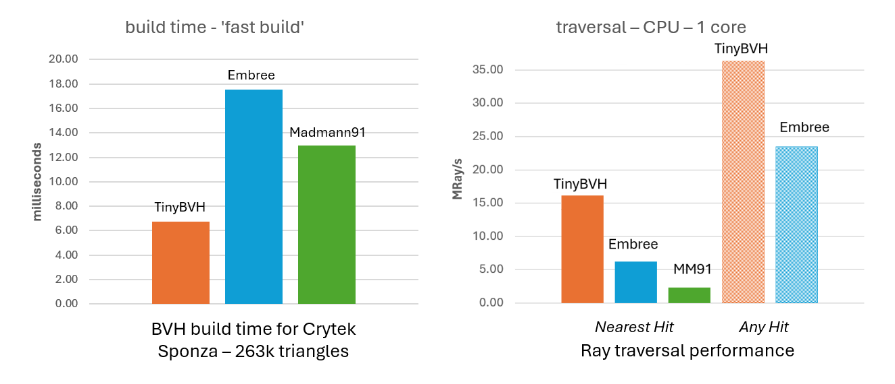
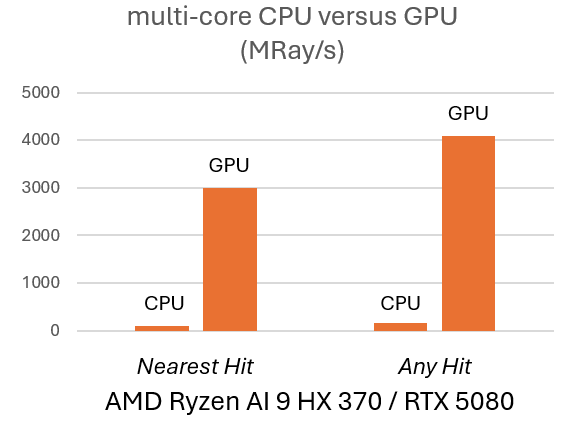
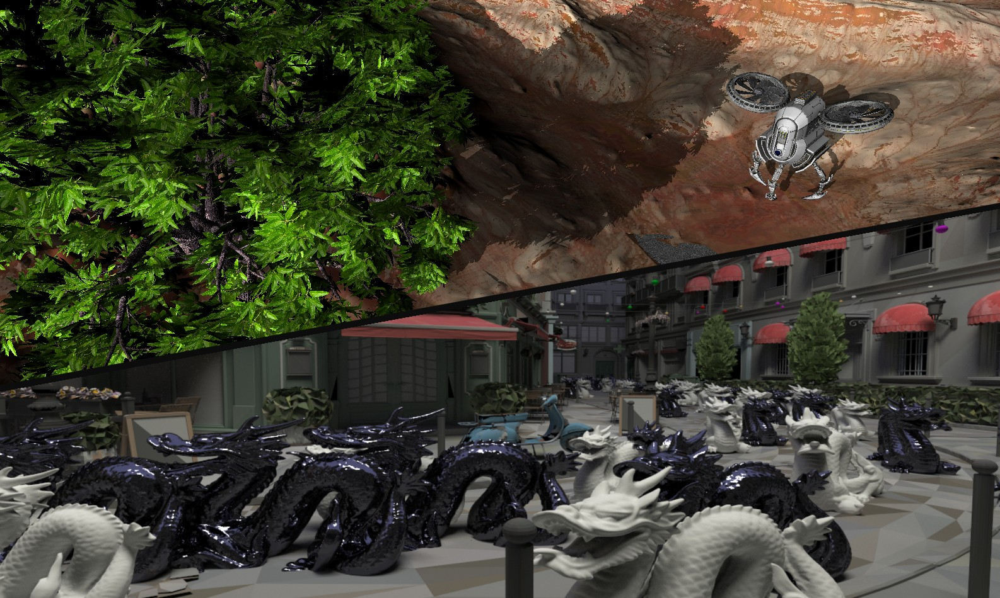
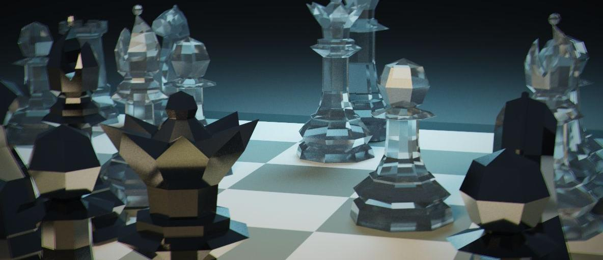
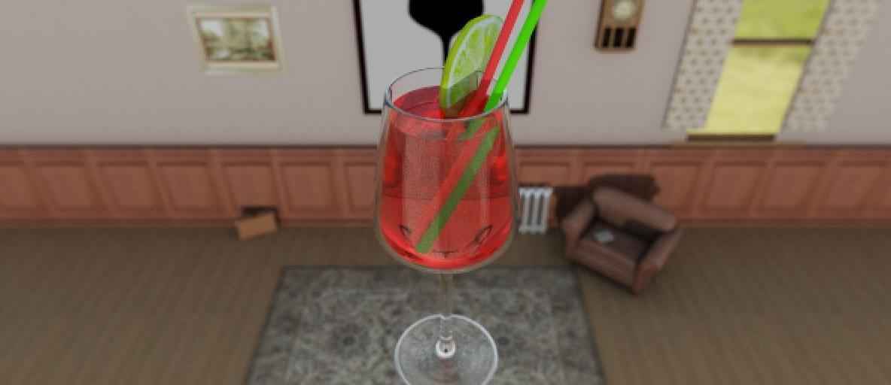

# TinyBVH

Header-only BVH construction and traversal library, written in C++14 / "Sane C++" (or "C with classes"), with C++17 for threading and a C API on top. **This library has no dependencies.**

Current version: **1.9.2**.

TinyBVH is _fast_. Here is, in a nutshell, how it compares to [Intel's Embree](https://www.embree.org) and [Madmann91's BVH library](https://github.com/madmann91/bvh):



TinyBVH builds a SAH BVH faster than Embree and Madmann91, and traces individual primary and 'any hit' rays faster than those libraries. These results come from `tiny_bvh_benchmark.cpp` and are cautiously presented as 'preliminary'; single-ray traversal is only a small part of Embree. If you suspect an imperfection in the experiment setup, please [let me know](mailto:bikker.j@protonmail.com).



On the GPU, (multicore) CPU performance is dwarfed: on an RTX 5080 laptop GPU, TinyBVH traces up to _5 billion rays_ per second in Crytek's Sponza using the basic binary BVH format, regardless of graphics API and without ray tracing hardware. That is 5 rays per pixel at 4k@120Hz.

---

**Contents:** [Getting started](#getting-started) &middot; [Builders](#builders) &middot; [Layouts](#layouts) &middot; [Geometry and traversal](#geometry-and-traversal) &middot; [TLAS and custom geometry](#tlas-instancing-and-custom-geometry) &middot; [Maintaining a BVH](#maintaining-a-bvh) &middot; [bvhopt](#offline-optimization-bvhopt) &middot; [Tools](#tools) &middot; [C API](#c-api) &middot; [Memory and threading](#memory-and-threading) &middot; [Configuration](#configuration) &middot; [Examples](#examples) &middot; [GPU and platforms](#gpu-and-platforms) &middot; [TinyBVH in the wild](#tinybvh-in-the-wild)

---

# Getting started

The library is `tiny_bvh.h` plus five headers next to it: `tiny_bvh_base.h` (platform-neutral code) and the SIMD kernels for x86 (`tiny_bvh_x86_float.h`, `tiny_bvh_x86_double.h`) and ARM (`tiny_bvh_arm_float.h`, `tiny_bvh_arm_double.h`). Keep them together, include only `tiny_bvh.h`, and define `TINYBVH_IMPLEMENTATION` in exactly one translation unit. For a single header with only the parts you use, see the [online customizer](https://jbikker.github.io/tinybvh/).

```cpp
#define TINYBVH_IMPLEMENTATION
#include "tiny_bvh.h"

tinybvh::BVH bvh;
bvh.Build( (tinybvh::bvhvec4*)myTriData, triangleCount );
tinybvh::Ray ray( tinybvh::bvhvec3( 0, 0, 0 ), tinybvh::bvhvec3( 0, 0, 1 ) );
bvh.Intersect( ray );   // hit if ray.hit.t < BVH_FAR; see ray.hit.prim, ray.hit.u, ray.hit.v
```

`myTriData` holds three vertices per triangle, each four floats: x, y, z and a dummy value that exists purely for a more efficient memory layout. Shadow rays use `bvh.IsOccluded( ray )`. Since 1.9, `Ray` does not normalize its direction: call `ray.Normalize()` where needed, or define `NORMALIZE_RAY_DIR` for the old behaviour.

See [`tiny_bvh_minimal.cpp`](https://github.com/jbikker/tinybvh/blob/main/examples/tiny_bvh_minimal.cpp) for a (really) small example, and the [Basic Use](https://jacco.ompf2.com/2025/01/24/tinybvh-manual-basic-use) and [Advanced Topics](https://jacco.ompf2.com/2025/01/25/tinybvh-manual-advanced) manuals for more. New to BVHs? Start with [this series of articles](https://jacco.ompf2.com/2022/04/13/how-to-build-a-bvh-part-1-basics).

# Builders

`Build` forwards to a specialized builder, selected via `bvh.settings` (a `BVHBuildSettings`):

| setting | builder |
| --- | --- |
| _(default)_ | **Bonsai** ([Ganestam et al., 2015](https://fileadmin.cs.lth.se/graphics/research/papers/2015/bonsai/)): grid cells become mini trees, built in parallel with the SIMD binned SAH builder, then pruned and combined under a top tree. |
| `useSpatialSplits` | **Bonsai HQ** ([Ganestam & Doggett, 2016](https://fileadmin.cs.lth.se/graphics/research/papers/2016/splitting/)): adds SAH-guided triangle splitting. |
| `binnedBVH` | **Binned SAH** with the AVX (x86) or NEON (ARM) builder; with `useSpatialSplits`: **SBVH** ([Stich et al., 2009](https://www.nvidia.in/docs/IO/77714/sbvh.pdf)), including "unsplitting". |
| `useSIMDifavailable = false` | Scalar reference binned SAH builder; SBVH with `useSpatialSplits`. |
| `usePresplitting` | Pre-splits triangles before building ([Karras & Aila, 2013](https://research.nvidia.com/sites/default/files/pubs/2013-07_Fast-Parallel-Construction/karras2013hpg_paper.pdf); [explanation](https://github.com/BoyBaykiller/IDKEngine) by BoyBaykiller). |
| `useFullSweep` | Full-sweep SAH builder, for experiments (with support from [BoyBaykiller](https://github.com/BoyBaykiller)). |
| `useHPLOC` | H-PLOC; builds trees identical to the NexusBVH CUDA code, for comparisons. |

Further settings:
* **Bonsai:** `bonsaiGridPrims` (grid resolution, in primitives per cell) and `bonsaiPruneFactor`.
* **SBVH:** `minSpatialOverlap` and `spatialSkipSmallestAxis`; `hqbvhbins`, `hqbvhoddeven` and `hqLeafPrims` are members of the BVH itself. Presplitting: `presplitFactor`, `presplitPostPass`.
* **General:** `keepSplitting` subdivides down to the leaf size whatever SAH prefers (`BVH4_CPU` and `BVH8_CPU` use it, leaving leaf formation to the collapse); `postOptimize` and `optimizeIterations`; `enableThreading`; `discardIntermediates`; `minimizeMemUse`.
* **Cost model:** `c_int` and `c_trav`, per BVH, defaulting to `C_INT` and `C_TRAV`.

Settings are per-BVH and are passed on to the layouts a BVH is built from:

```cpp
tinybvh::BVH4_CPU bvh;
bvh.settings.useSpatialSplits = true;   // Bonsai HQ
bvh.Build( (tinybvh::bvhvec4*)myTriData, triangleCount );
```

`BuildHQ` builds with spatial splits for that one build, `BuildSIMD` invokes the SIMD builder directly, and `BuildQuick` is a single-function midpoint-split builder for reference and debugging.

# Layouts

Instantiate the layout you need; it builds the intermediate representations it requires internally.

| layout | description |
| --- | --- |
| `BVH` | 32-byte nodes, two per cache line. Every other layout is produced from this one. |
| `BVH_Verbose` | 64-byte nodes with child and parent indices, for tree surgery and the optimizer. |
| `MBVH<M>` | M-wide intermediate format ([Wald et al., 2008](https://graphics.stanford.edu/~boulos/papers/multi_rt08.pdf)), used to produce the wide layouts. |
| `BVH4_CPU` | AVX2 / NEON 4-wide traversal (["WiVe"](https://web.cs.ucdavis.edu/~hamann/FuetterlingLojewskiPfreundtHamannEbertHPG2017PaperFinal06222017.pdf)), with octant-specialized kernels and four triangles per leaf. **The fastest option on CPU.** |
| `BVH8_CPU` | AVX2 8-wide WiVe traversal, left in for reference. |
| `BVH_GPU` | 64-byte nodes storing both child AABBs ([Aila & Laine, 2009](https://research.nvidia.com/sites/default/files/pubs/2009-08_Understanding-the-Efficiency/aila2009hpg_paper.pdf)), for a simple GPU kernel. |
| `BVH4_GPU` | Compact quantized 4-wide format for GPU ray tracing. |
| `BVH8_CWBVH` | 80-byte compressed 8-wide nodes for state-of-the-art GPU traversal ([Ylitie et al., 2017](https://research.nvidia.com/publication/2017-07_efficient-incoherent-ray-traversal-gpus-through-compressed-wide-bvhs); [code by AlanIWBFT](https://github.com/AlanIWBFT/CWBVH)). `CWBVH_COMPRESSED_TRIS` is off by default. |
| `BVH4_AMD_HW` | AMD hardware BVH4 format (BOX32 and triangle nodes), RDNA3 and up. By Alessandro Salo. |
| `CWBVH8_AMD_HW` | AMD RDNA4 hardware BVH8 format: BOX32 nodes, and primitive nodes holding up to eight triangle pairs. By Alessandro Salo. |
| `BVH_DOBB` | _Experimental._ 8-wide compressed nodes whose child boxes are stored in one of 104 discrete rotated frames ([Kern et al., 2025](https://arxiv.org/abs/2506.22849)). Bonsai only; no spatial splits yet. By [mmmuscus](https://github.com/mmmuscus). |
| `VoxelSet` | 256³ brick-based voxel object with DDA traversal, usable as a BLAS. |
| `BVH_Double`, `BVH4_Double` | Double-precision `BVH` and `BVH4_CPU` (AVX2 and NEON kernels), with 64-bit indices. |

Every layout is a template on scalar and index type: `<float, uint32_t>`, or `<double, uint64_t>` for the double precision ones. The wide CPU layouts fall back to portable scalar traversal where AVX2 or NEON is unavailable.

# Geometry and traversal

```cpp
bvh.Build( vertices, indices, triangleCount );          // indexed geometry
bvh.Build( bvhvec4slice( vertices, count, stride ) );   // interleaved vertex buffer (by David Peicho)
bvh.BuildAABB( aabbs, primCount );                      // BVH over AABBs
int32_t steps = bvh.Intersect( ray );                   // closest hit; result in ray.hit
bool occluded = bvh.IsOccluded( ray );                  // any hit, for shadow rays
bool hit = bvh.IntersectSphere( pos, r );               // sphere/BVH collision detection
```

Geometry is referenced, not copied. The exception: `BVH::Save` embeds the triangles by default, so a BVH loaded from such a file owns its geometry (`FreeGeometry` releases it).

* **Hit record.** `t`, barycentrics `u` and `v`, `prim`, and the instance index: a separate field, or the top bits of `prim` when `INST_IDX_BITS` is below 32. Plus 64 bytes of user data (a `void*` and a 56-byte union).
* **Ray masks.** 16-bit masks on rays and `BLASInstance`s; instances are skipped when they do not overlap, as in OptiX (by [Romain Augier](https://github.com/romainaugier)).
* **Bundles.** `IntersectBundle` and `IsOccludedBundle` on `BVH` and `BVH4_CPU` trace `TINYBVH_BUNDLE_RAYS` rays at a time (WiVeC, AVX2).
* **Opacity micro maps.** `SetOpacityMicroMaps( mapData, N )` attaches an N×N opacity map per triangle ([Gruen et al., 2020](https://dl.acm.org/doi/10.1145/3406180)), applied in the SIMD leaf tests.
* **Triangle tests.** Möller & Trumbore by default; [Baldwin & Weber (2016)](https://jcgt.org/published/0005/03/03/paper.pdf) for the precomputed leaf formats; `WATERTIGHT_TRITEST` selects [watertight intersection](https://jcgt.org/published/0002/01/05/paper.pdf) (Woop et al., 2013).

# TLAS, instancing and custom geometry

A _Top-Level Acceleration Structure_ is a BVH over instances, each referencing a BLAS with a 4x4 transform. BLASes of different layouts can be mixed, and a BLAS can be instanced many times:

```cpp
tinybvh::BVH blas;
blas.Build( (tinybvh::bvhvec4*)myTriData, triangleCount );
tinybvh::BLASInstance inst[2];
inst[0].blasIdx = inst[1].blasIdx = 0;
inst[1].transform = myMatrix;   // instance transform; inverted by the TLAS build
tinybvh::BVHBase* blasList[] = { &blas };
tinybvh::BVH tlas;
tlas.Build( inst, 2, blasList, 1 );
tlas.Intersect( ray );
```

Changing transforms and rebuilding the (small) TLAS gives cheap rigid animation. Custom primitives work through callbacks: an AABB function, plus `customIntersect` and `customIsOccluded`. This also works for double-precision BVHs, so triangles, custom geometry and voxel objects can share one scene.

# Maintaining a BVH

* **Refit.** `Refit` updates bounds for moved triangles: much faster than a rebuild, and fine for subtle animation. It does not work when the triangle count changes, nor for trees with spatial splits; `isRefittable()` tells you which.
* **Optimize.** `Optimize( iterations, mu, epsilon )` lowers SAH cost by parallel reinsertion (Meister & Bittner, 2018), on the thread pool; `mu` sets the search density (higher is sparser and faster). Also available as `settings.postOptimize`. _Changed in 1.9.2:_ the `extreme` and `stochastic` flags are gone. For static scenes, [bvhopt](#offline-optimization-bvhopt) goes much further.
* **Tree surgery.** `Compact` (multi-threaded), `MergeLeafs( maxLeafPrims )`, `SplitLeafs`, `CollectNodes` and `Depth`.
* **Quality metrics.** `SAHCost`, and `EPOCost`: "End-Point Overlap" ([Aila et al., 2013](https://users.aalto.fi/~ailat1/publications/aila2013hpg_paper.pdf)), weighted by `W_EPO`.
* **Serialization.** `Save` (returns `false` on failure) and `Load` for `BVH`, `BVH4_CPU`, `BVH8_CPU`, `BVH4_GPU`, `BVH8_CWBVH`, `BVH4_AMD_HW` and `CWBVH8_AMD_HW`. Every layout also has a static `Load( fileName, context )` that returns a finished object, converting a plain-BVH file where needed.

# Offline optimization: bvhopt

Where quality matters more than build time (static geometry, a tree you build once and ship), `tools/bvhopt.cpp` spends as long as it takes. It uses only the public API.

```
bvhopt <file.bvh> [options]                    optimize a binary BVH saved with its geometry
bvhopt <mesh.bin> --target <list> [options]    build optimized BVHs from a mesh
```

The first form writes `<file>_opt.bvh`. The second takes a mesh (a `uint32` triangle count, then three `float4` per triangle) and writes one BVH per target: `bvh`, `bvhgpu`, `bvh4cpu`, `bvh8cpu`, `bvh4gpu`, `bvh8cwbvh`, `bvh4amdhw`, `cwbvh8amdhw`, or `all`; each loads with its layout's static `Load`. It builds SBVH and spatial-split Bonsai candidates, optimizes them, collapses them with and without ray-visit weighting, and keeps the variant with the fewest box tests. Optimization rounds combine reinsertion, exact treelet restructuring, subtree rebuilds and reference unsplitting, followed by exact leaf formation for small subtrees.

`-profile fast|hq|extreme` sets how hard to look (a higher profile never returns a worse tree); `-metric sah|epo|raycost` sets what to minimize. `-advanced` lists the rest, such as a spatial-split prepass, geometry audit and repair, a measured round gate and fitting `c_trav`/`c_int` to timings.

# Tools

Stand-alone utilities in `tools/`, each a single source file with build instructions at the top:

| tool | purpose |
| --- | --- |
| `bvhopt.cpp` | Offline BVH optimizer, see above. |
| `tinybvh_custom.cpp` | Generates a single header with only the layouts, features and ISAs you need, optionally without templates. Also available [online](https://jbikker.github.io/tinybvh/), compiled to WebAssembly and running entirely in the browser. |
| `microbvh.cpp` | Condenses the headers into `microbvh.h`: a heavily compacted drop-in `tiny_bvh.h` for one target ISA. |
| `bvhcrop.cpp` | Crops or decimates a `.bin` mesh, to reproduce build problems on a smaller scene. |
| `obj2bin.cpp` | Converts `.obj` to `.bin`, with a colour estimated from the materials in `w`. |
| `tinyfmt.cpp` | Applies the TinyBVH coding standard to the headers. |

# C API

`tiny_bvh_c.h` is a plain C99 interface (C11 preferred), implemented by `tiny_bvh_c.cpp`, which contains TinyBVH and builds as a static or shared library. Each BVH is an opaque handle created for one layout. Functions return a `tbvh_result`, fatal errors inside TinyBVH come back as error codes rather than ending the process (except on build worker threads), and rays, hits and instances are binary-compatible with the C++ types. Opacity micro maps are not exposed yet.

```c
tbvh_bvh* bvh;
tbvh_create( TBVH_LAYOUT_BVH4_CPU, NULL, &bvh );
tbvh_geometry geo = { vertices, vertexCount, 0 /* stride: 16 */, NULL, 0 /* all triangles */ };
tbvh_build( bvh, &geo, TBVH_QUALITY_DEFAULT );
tbvh_ray ray;
tbvh_ray_init( &ray, 0, 0, 0, 0, 0, 1, 1e30f );
if (tbvh_intersect( bvh, &ray ) >= 0 && ray.hit.t < 1e30f) { /* ray.hit.prim, ray.hit.u, ray.hit.v */ }
tbvh_destroy( bvh );
```

# Memory and threading

Each layout owns its buffers, so the classes are move-only; `ReferenceFrom`, `ReleaseOwnership` and `DropReference` share buffers explicitly. Allocation and build parallelism go through `BVHContext`: `malloc`, `free`, `spawn`, `barrier` and `parallel_for` hooks, plus `userdata`. By default they use a built-in `std::thread` pool, created on the first threaded build and released at exit or by `tinybvh_shutdown_builtin_pool`. Define `TINYBVH_NO_BUILTIN_POOL` to bring your own pool (thanks [Wenzel Jakob](https://github.com/wjakob)), or `NO_THREADED_BUILDS` to drop threading; TinyBVH then compiles as C++14. `settings.enableThreading = false` keeps a build on the calling thread, for applications that build many BLASes at once, one per thread.

Fatal errors, including failed allocations, go through `tinybvh_fatal_error`, which never returns; install your own handler with `tinybvh_set_fatal_error_handler`.

# Configuration

Define these before including `tiny_bvh.h`:

| define | effect |
| --- | --- |
| `TINYBVH_IMPLEMENTATION` | emit the implementation in this translation unit |
| `BVHBINS`, `HQBVHBINS` | bins for regular / SBVH construction (default 8; SBVH at most `MAXHQBINS`) |
| `C_INT`, `C_TRAV` | default SAH cost of a primitive intersection / traversal step |
| `W_EPO` | weight of 'end point overlap' in the EPO calculation |
| `INST_IDX_BITS` | bits for the instance index; 32 stores it in a separate field |
| `TINYBVH_STACK_SIZE` | CPU traversal stack size (default 128) |
| `TINYBVH_BUNDLE_RAYS` | rays per `IntersectBundle` call; multiple of 8, max 256 |
| `WATERTIGHT_TRITEST` | watertight ray/triangle intersection |
| `NORMALIZE_RAY_DIR` | normalize ray direction in the `Ray` constructor |
| `DOBB_ALPHA` | `BVH_DOBB`: rotate a node if its oriented surface area is below alpha times its AABB area (default 0.9) |
| `TINYBVH_USE_CUSTOM_VECTOR_TYPES` | 'Bring Your Own Vector Types' (thanks [Tijmen Verhoef](https://github.com/nemjit001)) |
| `TINYBVH_ALIGNED_ALLOC` / `_FREE` | user-defined aligned allocation; define both (by [Thierry Cantenot](https://github.com/tcantenot)) |
| `TINYBVH_NO_BUILTIN_POOL` | do not create the built-in thread pool |
| `TINYBVH_NO_SIMD` | disable the SIMD paths |
| `PARANOID` | extra bounds checks, for debugging |
| `NO_DOUBLE_PRECISION_SUPPORT`, `NO_INDEXED_GEOMETRY`, `NO_CUSTOM_GEOMETRY`, `NO_THREADED_BUILDS`, `NO_VOXEL_SUPPORT` | compile out the corresponding feature |

Threaded builds are tuned with the `MT_*` defines at the top of `tiny_bvh.h`.

# Examples

A Visual Studio solution and a CMake file are included, but most examples are a single source file:

```
g++ examples/tiny_bvh_minimal.cpp
g++ -mwindows -O3 examples/tiny_bvh_viewer.cpp -I. -o tiny_bvh_viewer               # CPU ray tracing viewer
g++ -mwindows -O3 examples/tiny_bvh_pt.cpp -I. -o tiny_bvh_pt                       # multi-threaded path tracer
g++ -mavx2 -mfma -Ofast examples/tiny_bvh_speedtest.cpp -I. -o tiny_bvh_speedtest   # performance measurement
```

On macOS, use `c++ --std=c++17 -framework Cocoa` for the windowed examples and `-framework OpenCL` for the speedtest. The benchmark tool, which times and validates all builders and traversal kernels, builds with [build.bat](https://github.com/jbikker/tinybvh/tree/main/build.bat) / [build.sh](https://github.com/jbikker/tinybvh/tree/main/build.sh).

The [examples folder](https://github.com/jbikker/tinybvh/tree/main/examples) has many more small demos, among them OpenCL TLAS/BLAS traversal (`tiny_bvh_gpu2.cpp`), AMD hardware ray tracing with BVH4 and BVH8 (`tiny_bvh_amd_hwrt.cpp`, `tiny_bvh_amd_hwrt_bvh8.cpp`), a DOBB-BVH viewer (`tiny_bvh_dobb_test.cpp`), and OpenGL compute (`tiny_bvh_gl_compute`) and interop demos. The 'external' folder holds DXR and Vulkan benchmarks against TinyBVH; the Vulkan one also has OpenCL backends for the AMD hardware layouts.

# GPU and platforms

GPU traversal examples are provided for OpenCL, OpenGL compute, DirectX12 and Vulkan. `kernels/traverse_cwbvh.slang` is a [Slang](https://shader-slang.org) port of CWBVH traversal (by [Daniel Johansson](https://github.com/djohansson)), which compiles to SPIR-V, Metal, HLSL and the other Slang targets. For OpenCL, `tiny_ocl.h` is a single-header helper that selects a device, loads and compiles kernels (with include expansion, user defines and vendor/architecture `#define`s) and manages host/device buffers, including device-only ones. It links `OpenCL.lib` from the 'external' folder; `tiny_bvh.h` itself stays dependency-free.



TinyBVH builds with any C++17 compiler (C++14 without threading), including g++, clang, Visual Studio and Emscripten / WASM. Without AVX2 or NEON, every layout still builds and traverses on scalar code. Specifically supported:
* **x86-64 Windows/Linux:** optimized SSE / AVX / AVX2 build and traversal kernels.
* **ARM NEON**, including Android and Apple: NEON builder (by [wuyakuma](https://github.com/wuyakuma)) and traversal kernels, aligned allocation on Android, and dedicated Apple paths.
* **AMD RDNA3 / RDNA4:** `BVH4_AMD_HW` and `CWBVH8_AMD_HW` are traversed from OpenCL using AMD's BVH intersection intrinsics.

# TinyBVH in the Wild

A list of projects using TinyBVH:
* Remedy's [Northlight](https://www.remedygames.com/northlight) engine uses TinyBVH in their editor and for baking per-micro-vertex displacements.
* [EA SEED's Gigi](https://github.com/electronicarts/gigi/releases/tag/v1.0.0): uses TinyBVH for WebGPU ray tracing, "..as fast as when using the DXR api in DX12". Try the [demo](https://electronicarts.github.io/gigi/Demos/tinybvh/index.html).
* SideFX [Houdini](https://www.sidefx.com/docs/houdini/licenses) uses TinyBVH.
* [MuTracer](https://github.com/pissang/mutracer) by Yi Shen uses TinyBVH for real-time WebGPU path tracing in the browser.
* [wave_tracer](https://github.com/ssteinberg/wave_tracer) by Shlomi Steinberg uses TinyBVH to trace path segments.
* [TrenchBroomBFG](https://github.com/RobertBeckebans/TrenchBroomBFG), by Robert Beckebans. "TinyBVH allows to load bigger glTF 2 maps almost instantly instead of minutes".
* Jon Baker's [Icarus](https://jbaker.graphics/writings/icarusPLY.html) Point Cloud visualizer uses TinyBVH to represent geometry.
* The [Wonderland Engine](https://wonderlandengine.com/) for web-based 3D uses TinyBVH for WebGL ray tracing.
* [unity-tinybvh](https://github.com/andr3wmac/unity-tinybvh): an example implementation of TinyBVH in Unity and a foundation for compute-based ray tracing, by Andrew MacIntyre.

Created or know about other projects? [Let me know](mailto:bikker.j@protonmail.com)!

**Bindings and wrappers:**
* **C**: [`tiny_bvh_c.h`](#c-api), in this repository.
* **Rust**: [tinybvh-rs](https://docs.rs/tinybvh-rs/latest/tinybvh_rs), by David Peicho.
* **Python**: [pytinybvh](https://github.com/FlorentLM/pytinybvh), by Florent Le Moël.
* **.NET**: [TinyBVHNet](https://github.com/andersforsgren/TinyBVHNet), by Anders Forsgren, targeting `net48` and `net10.0`. Get it via [NuGet](https://www.nuget.org/packages/TinyBVHNet).

# Contribute

TinyBVH received features and bug fixes from [36 contributors](https://github.com/jbikker/tinybvh/graphs/contributors?all=1) so far. Thanks! Feel free to submit PRs; **please do so in the [development branch](https://github.com/jbikker/tinybvh/tree/dev)** for a good workflow.

# Contact

Questions, remarks? Contact me at bikker.j@protonmail.com or bikker.j@gmail.com or Bluesky: @jbikker.bsky.social .

# License

This library is made available under the MIT license, which starts as follows: "Permission is hereby granted, free of charge, .. , to deal in the Software **without restriction**". Enjoy. If you are using this work in your research, please cite TinyBVH: details are available in BibTeX and APA format, see the 'About' section for this repo on GitHub.

# Acknowledgement

The development of this library is supported by an AMD hardware grant.

# AI-use Statement

The development of TinyBVH involves the use of AI tools. Specifically, AI is used to steer refactoring, where it recommends improvements which are then manually processed. AI is also occasionally used to translate between ISAs and APIs, e.g. between x86-64 and NEON and between DirectX12 and Vulkan.

<br><br>


<p align="center"><i>Image credit: Tamara Heeffer, IGAD / Breda University</i> </p>

<br><br>


<p align="center"><i>Image credit: Hesam Ghadimi, IGAD / Breda University</i> </p>
